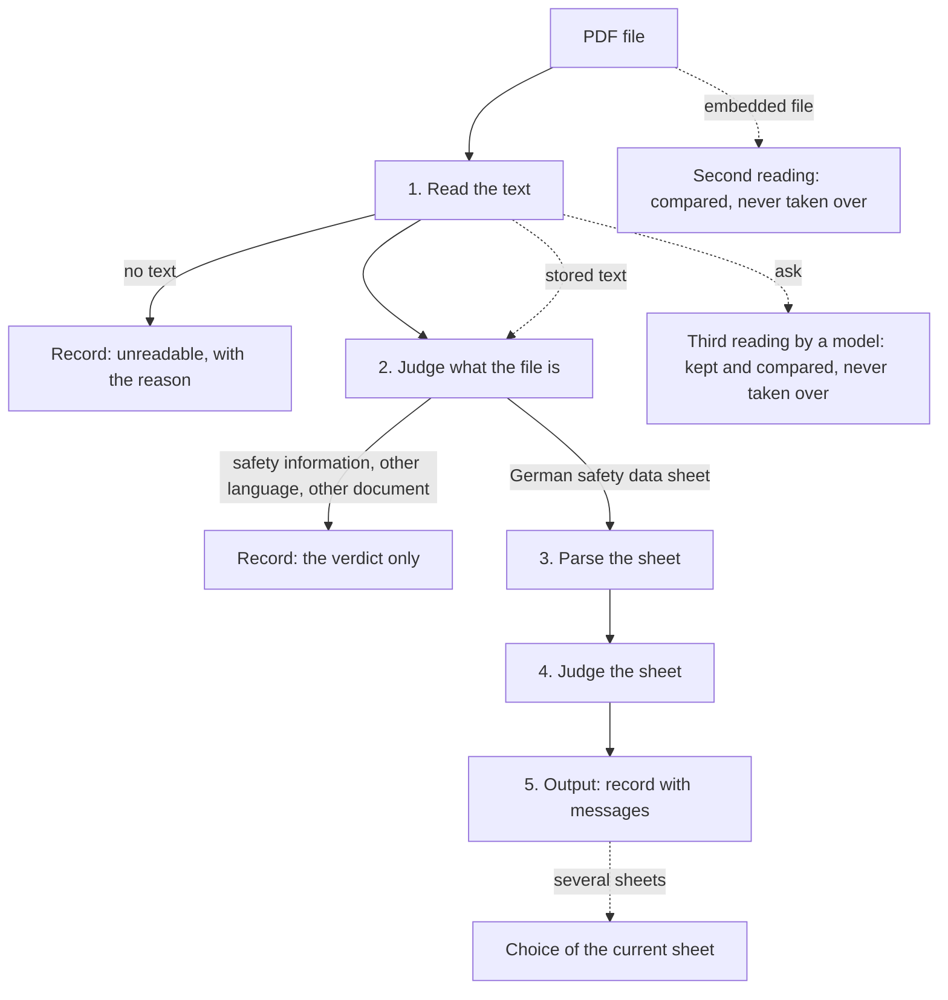

# How it works

The path of a file through the library, at a level that fits on one page.
Each step names the rules that govern it, by their IDs, so that you can go
from here to the binding text in [specs/](../specs/README.md). The specs are
in German; [Reading the specs](contributing/changes-and-specs.md#reading-the-specs-without-german)
helps if you do not read it.

## The philosophy behind the reader

- **Read what is printed, nothing else.** A reading holds what the sheet
  prints: its codes, its sentences, its dates, its supplier. The reader adds
  nothing a sheet "should" carry and corrects nothing it gets wrong. Where a
  label prints a statement only as a sentence, the reader names its code and
  says that the code was assigned, not printed.
- **Report, don't correct.** Where a sheet falls short of the CLP Regulation
  or REACH, the reader says so as a finding beside the reading. The findings
  name what its rules detect; they are a help, not a complete audit, and a
  sheet without a finding is not thereby in order.
- **Get the data right; leave the decision to the user.** The reader judges
  one file. Whether a product may be sold, which of several sheets applies,
  what to do about a finding: that is for whoever uses the reading, who knows
  the product, the shop and the law that applies to them.
- **Better missing than invented.** A rule reads only forms it can tell apart
  without guessing. Where a sheet words something in a way no rule covers, the
  reading leaves it out and says so ("not found"), instead of reading
  something that is not there. A missing value is easy to spot; an invented
  one looks right.
- **No model decides.** A sheet is read by written rules. A language model can
  be asked for a second opinion; it never changes a reading.
- **The same file gives the same result**, on every machine and in every run.
  Nothing depends on the machine's language, the file's name or the time,
  except where a rule says so (a date in the future is judged against the day
  of the run).
- **Every rule is written down and measured.** What the reader does follows a
  numbered rule; a change starts with its rule, a test names the rule it
  holds, and every change is read over a large collection of sheets and
  compared with the reading before. A case a rule reports is checked by hand
  when the rule is built; at run time the reader is trusted.
- **A reading never names its file.** The library judges content. Which file a
  reading belongs to, and which product a file belongs to, is the caller's
  knowledge.
- **The country, not the language.** What matters legally is the country a
  sheet is issued for; sheets for Germany, Austria and Switzerland are all in
  German.

## Why written rules and not a model

A language model reads a safety data sheet well. It understands a sentence it
has never seen, copes with a layout no rule foresaw, and often finds the
supplier where a rule picks the wrong line. The reader still reads with
written rules, for these reasons:

- **The same sheet gives the same answer.** A model may answer differently on
  a second run, even with the same input and settings. If a reading decides
  whether a product may be sold, it has to be repeatable.
- **It reads what is printed, by a rule you can look up.** Where a label
  prints a statement only as a sentence, models decide differently whether and
  which code to give, depending on the model and on how the question is put;
  some guess codes the sheet does not print. The reader follows a fixed rule
  and records for each code whether it is printed or assigned from the
  sentence. Where the sheet falls short of the regulation, it says so as a
  separate finding and corrects nothing.
- **Every answer can be traced.** Each value comes from a numbered rule, and
  each rule is tested. A wrong reading names the rule that erred.
- **A change can be measured.** Every rule change is read over a large
  collection of sheets and compared, sheet by sheet, with the reading before.
  A change that breaks other sheets shows up before it is released.
- **It runs anywhere, for free, offline.** No sheet leaves the machine,
  nothing is paid per page, and nothing depends on a service or a model
  version that may change.

**Where a model helps.** A model is good at finding what the rules do not
cover yet. `sdb-reader ask` puts a sheet to a model of your choice and keeps
its answer next to the reading; comparing the two shows the sheets where the
reader misses something, and those cases become new rules. Where a model's
answer is used, a check against the text helps: a value counts only if the
model quotes it and the quote is found in the sheet, as `ask` already does for
the revision date. The model finds the gaps; the rules close them. It never
changes a reading.

## The path of a file

The first step is the **reading stage**; steps 2 to 4 are the **parser
stage**. Each stage has a version, so that a caller knows when something it
kept is out of date.

## 1. Read the text

The PDF library gives the words of a page with their positions. The reader
puts them into the order of the print, not the order of the file: words on
one height form a line, from left to right, lines follow from top to bottom,
and a wide gap divides a line into cells. A word the file draws in pieces is
joined (SDB-42, SDB-99).

- **Pairs.** A label and its value on one line, divided by a colon, stay
  together as "label: value" (SDB-43).
- **Tables.** Rows of several cells without such a pair are a table, and its
  text stays in the order of the file, because positions alone do not say
  which cells belong together (SDB-44).
- **Forms in two columns.** In section 1, a numbered subsection heading at
  the left with its content at the right is read as a pair even without a
  colon (SDB-114).
- **Line breaks.** A word divided at the end of a line is joined (SDB-32,
  SDB-54); an empty line is kept where the page leaves room for one (SDB-45).
- **Text recognition.** A file without a text layer, or with one split into
  single characters, is rendered and read by `tesseract` (SDB-46). A single
  page that is a picture among pages with text is read the same way and put
  in its place (SDB-95).

A file no text can be read from ends here: it is a document, with the reason
as a message.

## 2. Judge what the file is

The verdict looks at the text only and sorts every file into one of four
kinds (SDB-66):

| Kind | Decided by |
| --- | --- |
| German safety data sheet | the title "Sicherheitsdatenblatt" at the start of a line, not merely in a sentence, and at least one of the sixteen sections (SDB-59, SDB-66, SDB-105) |
| Safety information | no title, but at least 12 of the 16 sections of a sheet (SDB-66) |
| Safety data sheet in another language | no German title, but the numbered subsections that Annex II of REACH prescribes in every language, recognised without knowing the language (SDB-68) |
| Document | anything else |

Only a German safety data sheet goes on to the parser.

## 3. Parse the sheet

- **Sections.** A section begins at its heading, "ABSCHNITT n" or a numbered
  title; several sheets in one file are told apart, and each is also read
  on its own beside the file's united reading; references to a section
  in running text and in change lists are not headings (SDB-1 to SDB-3,
  SDB-21, SDB-58, SDB-61, SDB-89, SDB-118, SDB-152). A cover page in front of the
  sheets is set aside and read for nothing but the word that names a
  display (SDB-138); whether the sheets are one product's is told from
  their product names (SDB-139).
- **The label of section 2.2.** Codes, signal word and pictograms are read
  from the label, which ends at the next heading (SDB-4). A code that stands
  only in a classification entry is not on the label (SDB-5). Where the
  label names no code, codes are read from the wording of the statements
  (SDB-6, SDB-28, SDB-122), not from the phrases of the rules
  before CLP (SDB-120, SDB-123); where it refers to 2.1 for its hazard statements,
  those of 2.1 count (SDB-119). A sentence that says a statement is not
  applied or not required is no label (SDB-78), and a code a narrow cell
  breaks or a space divides is read whole (SDB-121). The signal word is
  the printed one, or follows from the codes where the label says nothing
  (SDB-7, SDB-63, SDB-77); pictograms
  likewise, with the precedence of Article 26 CLP (SDB-8). Several sheets in
  one file are combined (SDB-9).
- **The statement texts.** The sentences of the H, P and EUH statements are
  cut from section 2: where a statement begins and ends, what belongs to a
  classification entry, what follows an EUH statement (SDB-10, SDB-27,
  SDB-41, SDB-51 to SDB-53, SDB-56, SDB-62, SDB-65, SDB-108 to SDB-110,
  SDB-127); an EUH statement keeps the substances printed before its code
  and counts only under a code the label carries (SDB-124, SDB-125).
- **The classification of section 2.** Whether section 2 classifies the
  product, classifies it under the directives before CLP, says it is not
  classified, or says neither (SDB-73, SDB-75, SDB-80, SDB-81, SDB-84 to
  SDB-88, SDB-104, SDB-106, SDB-107).
- **The product name.** The trade name of subsection 1.1: behind its label,
  on the label's line or the line below, or the line under the heading
  "Produktidentifikator" where the sheet prints no label; "Produktform:
  Gemisch" is not a name (SDB-131), nor is another label, a formula
  identifier or a heading (SDB-148). A value printed above its label is
  read (SDB-149), and where 1.1 gives no name, the sheet's header may
  (SDB-150).
- **The supplier.** Name, address, phone, e-mail and website from the block
  of section 1.3; the German company where the block names several (SDB-49,
  SDB-50, SDB-55, SDB-60). What only explains a label, a second company
  from the column beside it, the address on the name's line and a
  footnote's mark are not part of the name, and a poison centre's e-mail
  address is not the supplier's (SDB-132 to SDB-134, SDB-151). Beside the
  supplier's e-mail address, the first of the block, the reading keeps the
  address of whoever answers for the sheet: the competent person's, else an
  information office's (SDB-136).
- **Dates and version.** The newest revision and issue date the sheet names,
  and its version, in the many forms sheets print them (SDB-20, SDB-57,
  SDB-90 to SDB-94, SDB-96 to SDB-98, SDB-100 to SDB-103, SDB-128 to
  SDB-130). The date of a version the sheet only names, such as the one it
  replaces, is not its own; the day the version in hand was made is a
  revision date. A date after the day the caller names as today does not
  count for a sheet's age or for choosing the newest sheet, and is reported
  (SDB-137, BIB-19); the library reads no clock, the command passes the
  machine's date.
- **Countries.** The countries the sheet is issued for, of DE, AT and CH,
  from a country code behind the version or from the national rules and
  advice centres it names (SDB-69).

## 4. Judge the sheet

- **Whether the product needs a sheet.** It does where section 2 classifies
  it or the label carries an H or EUH statement, a signal word or a
  pictogram; any other sheet is issued voluntarily (SDB-72, SDB-76). A
  sheet that says of itself that it is voluntary or that none is prescribed
  is taken at its word where its product is an article, as the sheet says,
  or a mixture that is not classified; a classified mixture still needs
  one, and so does any product whose label offers the sheet on request
  (SDB-142). A sheet that says its product is an article and therefore not
  subject to labelling names an article too, voluntary or not (SDB-154).
- **Findings.** What is wrong with the sheet as a document: revised before
  2021 or still in the old layout, no readable date, classified under the old
  directives, a classification that is undetermined, not stated or
  contradicted by the label, an EUH statement outside the label, a statement
  worded differently from the regulation (SDW-6, SDW-7, SDW-9, SDW-10,
  SDB-79).
- **Statements for output.** Each statement is listed with the sheet's
  wording and the regulation's (SDW-5); statement texts can be brought into
  one form (SDB-17, SDB-18, SDB-30, SDB-47, SDB-126); H360 and H361 keep
  the letters of their effect (SDB-155).

The wording of the statements and the signal words are copies of the CLP
Regulation, kept in line with it by tools in the repository
([tools/clp/README.md](../tools/clp/README.md)).

## 5. Output

A reading becomes a record: the verdict, how the text was read, the sheet,
the statements and the findings (SDW-2, SDW-8). Its shape is described by a
JSON Schema that ships in the package (SDW-16), and every value stands in it
once (SDW-18).

Everything the library notes about a file is a **message**: a fixed code
with named values (BIB-10). The sentence a person reads comes from a
**catalog**, a text file per language; German and English ship, and a caller
can bring its own (BIB-11, SDW-17). Nothing decides by a sentence (BIB-12).

## Beside the path

- **Stored texts and stage versions.** Reading the text takes nearly all the
  time. A caller can store the text and read from it again (BIB-3). The
  reading stage and the parser stage each have a version that rises when the
  same input can give another result (BIB-4), and a test forces the decision
  whenever a stage's code changes (BIB-5).
- **The embedded file, a second reading.** Some PDFs carry the supplier's
  own export of the sheet in the format eSDScom. The library reads it and
  lists where it differs from the sheet as read. It takes nothing over: the
  sheet's data always come from the printed text (SDW-11, SDW-13).
- **A model's answer, a third reading.** `ask` sends the file's text up to
  section 3 to a language model and keeps what it says; the model gets
  nothing the parser made of the text, so it can also see what the parser
  cut away. `diff` sets the kept answers beside a reading, and two readings
  beside each other. The model's answer is only kept and compared
  (SDW-25 to SDW-31).
- **The choice among several sheets.** Which of a product's sheets is the
  current one is decided from plain data: revision date, country, version,
  issue date. The library does not know which sheets belong together; the
  caller says so (BIB-6 to BIB-9).
